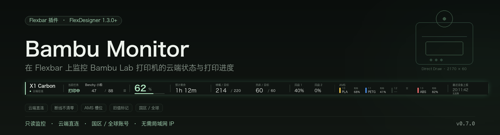
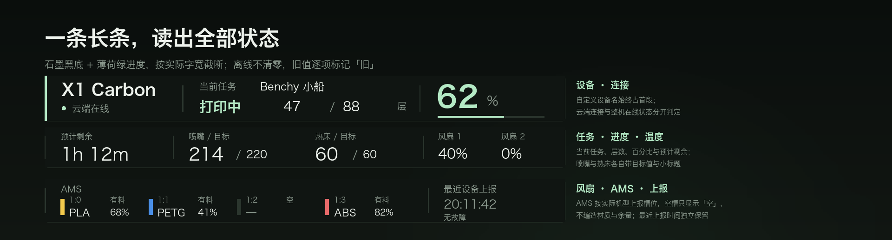
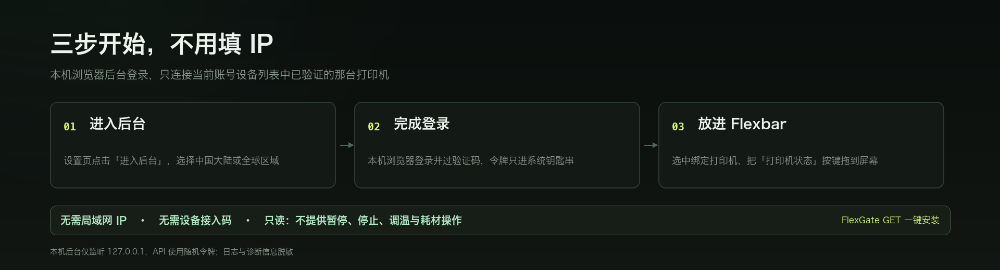
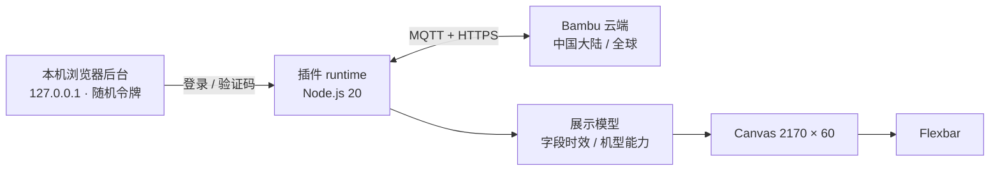

<div align="center">



<br />
<br />

**把 Bambu Lab 打印机的云端状态，压缩进 Flexbar 的一条 2170 × 60 长条。**
任务 · 层数 · 进度 · 剩余时间 · 喷嘴与热床 · 风扇 · AMS 槽位，一眼看全。

<p>
  
  
  
  
  
  
</p>

**[⬇ 下载最新安装包](https://github.com/UpKiry/flexbar-bambu-monitor/releases/latest)**  ·  **[📚 文档导航](docs/README.md)**  ·  **[🧾 v0.7.0 发行说明](docs/releases/v0.7.0.md)**  ·  **[🐛 反馈问题](https://github.com/UpKiry/flexbar-bambu-monitor/issues)**

</div>

> [!IMPORTANT]
> **只读监控。** 插件不提供暂停、恢复、停止打印、温度设置或耗材操作，只读取云端状态并按需查询完整状态。手动查询对每台设备设有 5 秒冷却，频繁请求仍可能影响打印机响应。

---

## ✨ 为什么是它

| 特性 | 说明 |
| --- | --- |
| 🎛 **一条长条，全部状态** | 石墨黑底配薄荷绿进度，任务、层数、百分比、剩余时间、双温、风扇与 AMS 收进 2170 × 60 的 Direct Draw 界面，不占额外空间。 |
| 🌐 **云端直连，免填 IP** | 走 Bambu 云端 MQTT / HTTPS，不需要局域网 IP、也不需要设备接入码；只连接当前账号设备列表里已验证的那台机器。 |
| 🧠 **状态不糊弄** | 云端连接、设备在线、打印活动三者分开维护；缺失保留、`null` 清空、`0` 有效，断线保留最后读数而不是清零装作空闲。 |
| 🏷 **旧值逐项标记** | 每个字段独立记录观测时间，过期只标「旧」，不合法的值不会刷新有效时间；AMS 按实际机型上报槽位，空槽就写「空」。 |
| 🔐 **默认安全** | 后台仅监听 `127.0.0.1`，API 使用随机令牌，日志与诊断信息脱敏；令牌只进系统钥匙串，插件配置不保存任何凭据。 |
| 🧩 **与宿主同行** | 普通按键点击切换视图，触摸屏幕请求完整状态，结果在同一绘制层的任务名一行反馈，避免原生弹窗与整屏刷新叠加。 |

---

## 🖼 界面



| 段落 | 读什么 |
| --- | --- |
| **设备 · 连接** | 自定义设备名永远占首段，不用型号顶替；云端连接与整机在线状态分开判断。 |
| **任务 · 进度 · 温度** | 当前任务、`47 / 88` 层、进度百分比与预计剩余；喷嘴与热床各自带目标值。 |
| **风扇 · AMS · 上报** | 风扇按机型能力显示；AMS 展示实际单元 / 槽位 ID、颜色、材质与可用余量，AMS lite 隐藏余量；最近上报时间独立保留。 |



---

## 🚀 快速开始

需要 **FlexDesigner 1.3.0+** 与 **Flexbar**（manifest 声明 macOS 10.15+ / Windows 10+）。

1. **安装** —— 用 FlexDesigner 安装 [Releases](https://github.com/UpKiry/flexbar-bambu-monitor/releases/latest) 中的 `com.upkiry.bambumonitor.flexplugin`。
2. **登录** —— 打开插件设置，点击 **进入后台**，选择账号区域（中国大陆 / 全球），在本机浏览器完成登录与验证码。
3. **上屏** —— 选中已绑定的打印机，把「打印机状态」按键拖到 Flexbar。

> [!TIP]
> 浏览器若未自动打开，可使用插件设置页显示的本机地址。后台地址含有访问凭据，请勿分享；密码、验证码、令牌、设备接入码与完整云端响应同样不要提交到 issue。

<details>
<summary><b>从源码构建 / 开发调试</b></summary>

```sh
nvm use                 # Node.js 20，FlexCLI 在 Node 26 下会崩
npm install
npm test                # node:test，无需框架
npm run build           # Rollup 打包到插件目录 backend/
npm run plugin:validate
npm run plugin:pack
npm run plugin:install  # 覆盖安装，需先启动 FlexDesigner
```

开发时 `npm run dev` 会链接插件、监听源码与 UI 文件并重启插件输出调试日志；不启动 FlexDesigner 时，`npm run admin:dev` 可在图形桌面会话中单独打开后台（配置与登录状态只保存在内存）。

</details>

---

## 🧭 状态怎么读

| 概念 | 取值 | 说明 |
| --- | --- | --- |
| **云端连接** | 等待同步 / 在线 / 中断 / 未知 | 与账号的连接是否正常；中断时设备状态退化为未知，不猜在线。 |
| **设备在线** | 在线 / 明确离线 / 无响应 / 未知 | 只有有效打印遥测才证明在线；明确事件才判离线，沉默仅判无响应（整体 120 秒无有效遥测）。 |
| **打印活动** | 打印中 / 暂停 / 完成 / 空闲 … | 与在线状态独立维护；离线不会把任务改写成空闲。 |
| **旧值标记** | 「旧」 | 字段级观测时间；持续有效的遥测不会让稳定读数仅因单字段年龄被误标。 |

自动刷新遵循统一调度：订阅后 5 秒按需补全核心字段；在线字段缺失或标旧持续 30 秒后有限补全；健康时每 15～16 分钟低频兜底；失活 120 秒后有限恢复。自动请求至少间隔 5 分钟，与手动查询协调，字段补全与恢复各有预算，重连不绕过预算。完整规则与待真机验证的阈值见 [设备协议与状态模型](docs/设备协议与状态模型.md)。



---

## 🔐 隐私与安全

- 令牌只进系统安全存储（macOS 钥匙串），插件配置只保存区域、所选设备 ID 与名称。
- 后台仅监听 `127.0.0.1`，API 使用随机令牌；日志经过 `src/util/logger.js` 脱敏，不记录密码、验证码、令牌、授权头或设备接入码。
- 设备列表在适配层即丢弃 `dev_access_code`，原始完整响应不会写进日志或测试样本。
- macOS 写入钥匙串失败或不可用时会提示并回退到内存（重启需重新登录）；Windows 的持久化凭据存储尚未实现。

---

## 🛠 技术栈

<p>
  
  
  
  
  
</p>

- **入口分层**：`src/plugin.js` 只做事件接线与生命周期，`src/runtime.js` 负责宿主事件、配置读写、UI 消息分发与绘制调度。
- **依赖显式注入**：`auth/`、`cloud/`、`printer/`、`display/`、`util/` 按职责分层，通过 `createApi`、`createMqttClient`、`drawKeyFn` 传入依赖，可脱离宿主测试。
- **发布目录**：`com.upkiry.bambumonitor.plugin/` 是 FlexDesigner 读取的插件目录（`manifest.json` + `ui/` + `resources/`），构建产物 `backend/` 不入库。
- **测试**：27 个 `node:test` 文件、418 项断言，覆盖 mapper / reducer / presence / 调度预算 / Direct Draw / 后台安全边界。

---

## 🗺 路线与待验证

- [x] macOS · FlexDesigner · 国区账号 · A1 + AMS 只读监控（已有用户总体验收）
- [x] 精炼长条界面与同层刷新反馈（v0.7.0 汇总）
- [x] Node 20 全量测试、生产构建、插件校验与打包（CI 内同样执行）
- [ ] 自动恢复阈值、异常恢复路径的真机逐项验证
- [ ] 多机型（X1 / P1 / A1 mini / AMS lite / 九槽）边界
- [ ] Windows 实机与持久化凭据存储
- [ ] macOS 钥匙串授权与重启恢复的真机验证

当前候选、安装记录与逐项待验收清单统一记录在 [验证状态](docs/验证状态.md)，构建通过不等于真机通过。

---

## 📚 文档地图

| 想做什么 | 去哪里 |
| --- | --- |
| 配置环境、找目录、写代码、构建测试 | [开发指南](docs/开发指南.md) |
| 理解登录、模块关系、多设备与绘制生命周期 | [架构设计](docs/架构设计.md) |
| 改 MQTT、字段映射、在线状态、时效、机型或 AMS | [设备协议与状态模型](docs/设备协议与状态模型.md) |
| 看 0.7.0 改了什么 | [v0.7.0 发行说明](docs/releases/v0.7.0.md) |
| 确认测过什么、还缺什么 | [验证状态](docs/验证状态.md) |
| 在 macOS 上做真机验收 | [macOS 真机验收指南](docs/macOS真机验收指南.md) |

---

## ⚖️ 许可证与致谢

本项目采用 [MIT License](LICENSE)。本项目与 Bambu Lab、Flexbar 官方无关联；云端接口与设备字段可能随服务、机型或固件变化。

<div align="center">
<br />
<sub>Made with ☕ and 薄荷绿 for <a href="https://flexgate.enilinx.com/home/plugin">FlexGate</a> · 如果它让你的打印任务少看一眼手机，就给个 ⭐</sub>
</div>
