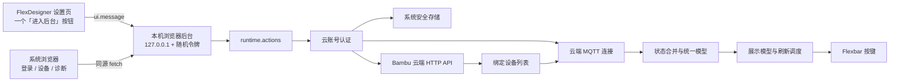

# Bambu Monitor 云端优先设计方案

## 1. 项目目标

为 Flexbar 开发一款 Bambu Lab 打印机状态监控插件。用户从 FlexDesigner 设置页进入本机浏览器后台，登录 Bambu 云账号并选择已绑定的打印机，然后在 Flexbar 上查看设备状态和打印进度。

项目优先接入云端，无需用户填写打印机局域网 IP 或 LAN Access Code。第一阶段先完成账号登录和设备发现，随后实现云端实时监控；阶段 4 将登录与设置迁到浏览器后台，以改善输入、验证码和调试体验。打印控制、摄像头及历史统计暂不纳入第一版。

> 本文既是实施方案，也是进度记录。截至 2026-11-19，阶段 1、阶段 2 与浏览器后台的代码已完成并通过单元测试，但尚未用真实账号与打印机验收；各阶段的实际状态见第 8 章。

## 2. 背景与约束

- 插件后台运行在 FlexDesigner 的 Node.js 环境；设置页通过插件机制只做入口，登录与设置在本机浏览器后台完成，Flexbar 按键由后台绘制。
- 当前项目使用 FlexCLI、JavaScript、Rollup 和 FlexDesigner SDK。先沿用现有工具链，按职责拆分模块。
- 社区整理的 Bambu 个人账号云接口和 MQTT 协议并非本文所能确认的稳定官方公共 API；登录方式、区域地址和可用字段可能变化，需要针对实际账号、机型和固件验证。
- Bambu 的 [Fleet Hub 开发者接入](https://bambulab.com/en/fleet-hub/developer)是另一条官方接入路径，其适用范围与普通个人账号的关系需要另行确认。
- 用户需在设置中明确选择账号区域；不能根据系统时区或 IP 地址猜测账号区域。

## 3. 用户体验

### 3.1 初始配置

1. 用户在 FlexDesigner 中打开插件设置；设置页只显示登录 / 打印机状态和一个「进入后台」按钮。
2. 点击按钮后，插件在本机 `127.0.0.1` 的随机端口启动带令牌的浏览器后台，并拉起系统默认浏览器。
3. 在浏览器后台中选择账号区域：全球账号填写邮箱，中国大陆账号填写手机号；输入密码后，服务端要求时继续输入邮箱或短信验证码。
4. 登录成功后，插件读取当前账号绑定的设备列表；用户在后台选择要显示的打印机。
5. 用户将监控按键添加到 Flexbar，插件连接云端状态通道；收到数据后显示设备状态。

浏览器后台仅监听回环地址，插件退出后失效；浏览器没有自动打开时，设置页会显示完整地址供手动访问。后台与 FlexDesigner 设置页共用同一套 `runtime.actions`，避免出现两套登录状态。

### 3.2 Flexbar 展示

| 情况 | 建议显示 |
| --- | --- |
| 未登录 | 请登录 Bambu 账号 |
| 登录已失效 | 登录已失效，请重新登录 |
| 未选择打印机 | 请选择打印机 |
| 连接中 | 正在连接云端 |
| 等待首次状态 | 等待打印机状态 |
| 打印机离线 | 打印机离线及最后更新时间 |
| 空闲 | 打印机空闲，可附可用温度 |
| 打印中 | 进度、剩余时间及可用温度 |
| 暂停 | 已暂停及当前进度 |
| 完成 | 打印完成 |
| 异常 | 打印异常及可确认的错误码 |
| 云端断开 | 云连接中断及最后更新时间 |

按键可切换进度、温度和任务信息视图。实际布局和支持字段以 Flexbar、FlexDesigner 和目标机型实测为准。

## 4. 总体架构



模块职责：

1. **认证模块**：处理登录状态、验证码、令牌有效性和退出登录。
2. **云 API 模块**：封装区域配置、HTTP 请求和设备列表；只暴露应用所需的数据，并输出脱敏请求追踪。
3. **设备管理模块**：管理已选设备和监控生命周期，为多设备扩展预留空间。
4. **云 MQTT 模块**：连接、订阅、重连、接收原始状态报告。
5. **状态模块**：合并完整及增量报告，映射为统一领域模型。
6. **展示模块**：生成显示内容、限制绘制频率，并处理 FlexDesigner 按键事件。
7. **凭据存储模块**：通过明确的接口访问系统安全存储，避免业务层直接处理平台差异。
8. **浏览器后台模块**：本机 HTTP 服务、令牌鉴权、静态管理页和脱敏诊断；只转发 `runtime.actions`，不复制业务逻辑。

## 5. 账号登录设计

### 5.1 登录状态机

```text
未登录 → 登录中 → 等待验证码 / 等待二次验证 → 已登录
                       ↘ 登录失败，可由用户重试

已登录 → 令牌过期或被撤销 → 需要重新登录
```

服务端的响应决定后续步骤；遇到未支持的认证方式时，说明限制并停止，不绕过验证。界面区分账号密码错误、验证码错误或过期、请求受限、网络失败及区域不匹配等情形。认证失败和限流时不循环自动提交。

### 5.2 实现依据

[OpenBambuAPI 云接口资料](https://raw.githubusercontent.com/Doridian/OpenBambuAPI/main/cloud-http.md)与 [ha-bambulab](https://github.com/greghesp/ha-bambulab) 的实现记录了以下接口，可作为技术验证的起点：

- `POST /v1/user-service/user/login`：账号登录；密码登录和验证码登录都走这里。
- `POST /v1/user-service/user/sendemail/code`：邮箱验证码，请求体 `{ email, type: "codeLogin" }`。
- `POST https://api.bambulab.cn/v1/user-service/user/sendsmscode`：国区短信验证码，请求体 `{ phone, type: "codeLogin" }`。ha-bambulab 使用 `https://bambulab.cn/api/...` 的网站主机，但该主机有 Cloudflare 挑战；实测 API 主机同一路径可直接访问，Node 客户端应走 API 主机。
- `GET /v1/iot-service/api/user/bind`：获取绑定设备。
- `GET /v1/design-user-service/my/preference`：社区资料中用于获取云 MQTT 所需用户标识。

这些资料是社区整理结果，不能保证当前所有账号、区域和认证方式可用。请求参数、验证码流程、服务地址及账号权限需要逐项验证；应用层不直接依赖固定响应结构，统一由云端适配器转换和处理错误。

已实现：`src/cloud/cloud-api.js` 向业务层暴露 `login` / `requestVerificationCode`（兼容 `requestEmailCode`）/ `fetchDevices` / `fetchUserId` / `logout`；错误归类为账号密码错误、验证码错误或过期、请求受限、网络失败、超时、未授权、区域不匹配等，界面据此给出可操作提示。社区资料提示令牌刷新接口目前基本不可用，因此 `refreshToken()` 已实现但默认不启用，过期即要求重新登录。

国区登录按 [ha-bambulab](https://github.com/greghesp/ha-bambulab) 的实测实现处理：账号里带 `@` 视为邮箱，调用 `/v1/user-service/user/sendemail/code`；否则视为手机号，调用 `https://api.bambulab.cn/v1/user-service/user/sendsmscode`，请求体为 `{ phone, type: "codeLogin" }`。验证码仍提交到登录接口 `{ account, code }`。国区账号只接受手机号，全球账号只接受邮箱；手机号允许输入空格 / 连字符，提交前会去掉分隔符。

### 5.3 令牌与凭据

- 密码和验证码仅用于当前认证流程，不持久化；登录完成或取消后从可控内存引用中清除。
- 优先使用 macOS 钥匙串或 Windows 凭据管理器保存令牌。能否从当前插件运行环境可靠调用安全存储，须先做跨平台验证。
- 普通插件配置仅保存区域、所选设备 ID 和非敏感显示偏好；不能假设 SDK 配置存储适合保存密钥。
- 令牌、密码、验证码、授权头和原始完整响应均不得写入日志。设备列表可能包含 LAN Access Code，诊断信息也需脱敏。
- 令牌过期或被撤销后提示用户重新登录。[社区资料](https://raw.githubusercontent.com/Doridian/OpenBambuAPI/main/cloud-http.md)提示其记录的令牌刷新接口可能不可用；仅在当前账号实际验证成功后启用刷新。
- 退出登录时关闭云连接、删除本地令牌并清除设备缓存。服务端会话能否同时撤销，取决于接口是否可用及验证结果。
- 浏览器后台的令牌每次插件启动随机生成，放在 URL fragment 中并由页面保存到 `sessionStorage`；API 使用 `Authorization: Bearer` 校验。令牌不写入插件配置、不写日志、不放 query，避免进入代理日志或历史记录。
- 后台只监听 `127.0.0.1` 随机端口，校验 Host / Origin，禁 CORS，并对登录 / 发码等操作限速；不绑定 `0.0.0.0`，默认不支持手机等局域网设备访问。
- 诊断只记录云端请求的方法、路径、状态码、错误类型和耗时，不记录请求头、请求体、响应体、密码、验证码或令牌。

## 6. 设备发现与云端监控

### 6.1 设备列表

登录后读取账号下的绑定设备，展示设备名称、型号和在线状态。用户选择设备后保存其 ID；不依赖用户手工输入打印机 IP。后续多个按键可选择不同打印机，共享账号会话和设备连接。

设备列表为空、无权限、服务不可用分别给出明确提示；设备名称变更、解除绑定及账号切换后应刷新本地选择状态。

### 6.2 云 MQTT

[OpenBambuAPI MQTT 文档](https://raw.githubusercontent.com/Doridian/OpenBambuAPI/main/mqtt.md)描述了使用云账号令牌连接 MQTT 并订阅 `device/{DEVICE_ID}/report` 的社区方案。实际使用前必须验证目标区域的服务地址、用户标识、令牌权限、TLS 证书和该账号的设备推送能力。

- 连接成功后订阅所选设备的状态主题，处理云端状态报告。
- 使用 TLS 并验证证书，不全局关闭验证。
- 网络断开采用带随机抖动的指数退避重连；认证失效时停止持续重试，提示重新登录。
- 若需要主动请求完整状态，应先验证目标云端路径和机型是否支持。此类请求是状态查询，不是打印控制；请求频率需受限。[社区资料](https://raw.githubusercontent.com/Doridian/OpenBambuAPI/main/mqtt.md)建议 P1P 的 `pushall` 间隔至少 5 分钟，避免影响设备性能。重连和手动刷新应共享冷却限制。
- 如 MQTT 在目标账号或机型上不可用，另行评估云 HTTP 状态接口作为低频、非实时降级；显示最后更新时间，不承诺其包含温度或所有实时字段。

### 6.3 状态模型

```ts
type PrinterState = {
  printerId: string;
  connection: 'connecting' | 'connected' | 'disconnected' | 'error';
  activity: 'unknown' | 'idle' | 'preparing' | 'printing'
          | 'paused' | 'finished' | 'failed';
  progressPercent: number | null;
  remainingMinutes: number | null;
  taskName: string | null;
  nozzle: { current: number | null; target: number | null };
  bed: { current: number | null; target: number | null };
  errorCode: string | null;
  lastReportAt: number | null;
};
```

`null` 表示未知或不可用，不转换成零。无法识别的原始状态映射为 `unknown`，错误码仅在含义可确认时解释，否则显示原始错误码。字段与单位必须以目标机型和真实报文验证。

| 业务信息 | 社区资料中的常见字段 | 处理 |
| --- | --- | --- |
| 设备状态 | `gcode_state` | 映射为统一状态，未知值保留 |
| 打印进度 | `mc_percent` | 检查范围 0–100 |
| 剩余时间 | `mc_remaining_time` | 通常按分钟处理，实机确认 |
| 任务名称 | `subtask_name` | 显示时截断过长内容 |
| 喷嘴温度 | `nozzle_temper`、`nozzle_target_temper` | 显示当前值和可用目标值 |
| 热床温度 | `bed_temper`、`bed_target_temper` | 显示当前值和可用目标值 |
| 异常 | `print_error`、`hms` 等 | 按已验证的映射显示 |

### 6.4 增量合并与刷新

- 部分设备报告增量字段：缺失字段保留已有值，显式空值按已验证的字段语义处理。
- 数组不能一律深合并；AMS 等复杂字段需单独建模，第一版可暂不解析。
- 每次报告记录时间；必要时为字段记录更新时间。连接存活不等同于所有数据均为最新。
- 收到完整快照、设备切换、账号切换及任务切换时，按明确规则清理旧字段，避免把旧任务数据带入新任务。
- 数据到达时立即更新内存；Flexbar 常规绘制初始建议最多每秒一次，状态切换、断线和故障可立即更新。
- 完成与故障通知按任务标识和状态转换去重。剩余时间以设备上报为准，本地估算必须明确标注并在新数据到来时校正。

已实现：`state-reducer.js` 按上述规则合并，`presenter.js` 的 `createDrawThrottle` 负责节流（首帧立即绘制，常规更新每秒最多一次，紧急更新立刻绘制，另有定时器补画被节流的更新）。通知去重的工具函数已提供，但第一版尚未发送系统通知。

## 7. 工程结构

```text
src/
  plugin.js                   # FlexDesigner 入口、事件接线及退出清理
  runtime.js                  # 宿主事件、配置读写、UI 消息、后台控制与绘制调度
  admin/
    server.js                 # 127.0.0.1 后台 HTTP 服务、令牌、路由与静态页
    diagnostics.js            # 脱敏日志 / 云端请求时间线缓冲
    open-browser.js           # 跨平台拉起默认浏览器
  auth/
    auth-service.js           # 登录状态机
    credential-store.js       # 系统安全存储接口
  cloud/
    cloud-api.js              # 云 HTTP 请求、响应适配与脱敏请求追踪
    region.js                 # 账号区域配置
    cloud-mqtt.js             # MQTT 连接和重连
  printer/
    printer-manager.js        # 设备管理与监控生命周期
    state-reducer.js          # 快照和增量合并
    state-mapper.js           # 原始状态转统一模型
  display/
    presenter.js              # 状态转展示模型（含绘制节流）
    key-renderer.js           # 调用 FlexDesigner 绘制 API
  util/
    logger.js                 # 脱敏日志

scripts/
  admin-dev.js                # 不启动 FlexDesigner 的后台开发入口

com.upkiry.bambumonitor.plugin/
  manifest.json               # 按键、配置入口与本地化文案
  ui/
    configPage.vue            # 只保留状态文字和「进入后台」按钮
    monitor.vue               # 单按键视图选择（进度 / 温度 / 任务）
  resources/
    admin/                    # 浏览器后台静态页（index.html / app.js / style.css）

test/
  auth-service.test.js
  cloud-api.test.js
  cloud-mqtt.test.js
  printer-manager.test.js
  presenter.test.js
  runtime.test.js
  state-reducer.test.js
  state-mapper.test.js
  util.test.js
```

计数器示例已被监控按键替换；入口只负责协调事件和服务，不承载协议细节。配置界面与后台的消息方式、SDK 包名和可用接口以项目实际安装版本及实测为准。参考 [FlexDesigner SDK 文档](https://eniac-tech.github.io/FlexDocumentation/flexbar/en/sdk/sdk_api_reference.html)。

实现说明：

- 云端 HTTP 与 MQTT 都封装在可注入的适配层（`requestFn`、`createClient`），因此协议可以在真实账号验证前用假响应完整覆盖。
- `mqtt` 依赖会随插件一起打包进 `backend/plugin.cjs`，发布包不依赖宿主的 `node_modules`。
- 配置页与按键配置页分别是 `ui/configPage.vue`、`ui/monitor.vue`，与 manifest 中的 `configPage` 和按键配置名对应。
- 浏览器后台的静态文件放在 `resources/admin/`，不使用 Vue/Vuetify 或 CDN，避免给插件包增加前端依赖；页面只通过同源 `fetch` 调用后台 API。
- 插件启动时即创建后台服务，设置页点击按钮只负责拉起浏览器；启动失败不会影响 Flexbar 监控，设置页仍会显示错误和手动地址。

## 8. 分阶段实施与验收

### 进度总览（2026-11-19）

| 阶段 | 状态 | 说明 |
| --- | --- | --- |
| 阶段 0：技术验证 | 部分完成 | 已用公开资料与网络探测确认接口地址、错误码形态与云端 TLS 证书；尚未用真实账号验证登录与设备推送 |
| 阶段 1：登录与设备发现 | 代码完成，待真机验收 | 状态机、验证码、安全存储、设备列表与选择、退出登录均已实现并有单元测试 |
| 阶段 2：云端监控 | 代码完成，待真机验收 | MQTT 连接、订阅、抖动退避重连、增量合并、按键展示与绘制节流均已实现 |
| 阶段 3：体验与扩展 | 部分完成 | 已支持按键视图切换（进度 / 温度 / 任务）；多设备、AMS、通知去重尚未接入 |
| 阶段 4：浏览器后台 | 代码完成，待真实账号验收 | 本机 HTTP 后台、令牌鉴权、登录 / 设备 / 退出、脱敏诊断、设置页单按钮入口均已实现；真实浏览器登录操作待验收 |

已完成的技术探测（无需账号即可确认）：

- `https://api.bambulab.com` 与 `https://api.bambulab.cn` 均可达，错误响应为 `{"code":1,"error":"Incorrect account or password."}` 这类 JSON，与社区资料一致。
- 未带令牌访问 `GET /v1/iot-service/api/user/bind` 返回 `{"code":4,"error":"Please login."}`，说明鉴权语义与资料一致。
- `us.mqtt.bambulab.com:8883` 与 `cn.mqtt.bambulab.com:8883` 使用 TLS，证书由 DigiCert 签发、CN 为 `*.mqtt.bambulab.com`，可正常校验；未认证连接会被立即断开，符合"必须带令牌"的预期。
- 插件 utility process 可以监听回环端口：安装后日志出现"浏览器后台已监听 127.0.0.1:随机端口"，静态页返回 200，未带令牌的 `/api/status` 返回 401。设置页按钮到浏览器的完整点击链路仍需人工验收。

仍未验证（必须由真实账号与设备补齐，不能默认通过）：

1. 账号实际触发的登录验证类型（密码直登 / 邮箱验证码 / 国区短信验证码 / 双重认证），以及国区 `sendsmscode` 在真实手机号上的响应与限流行为。
2. 云 MQTT 能否成功订阅目标设备，以及推送频率、字段完整性与 AMS 数据。
3. 系统钥匙串在插件进程内的实际读写权限。本机沙箱中 `security` 返回 `Operation not permitted`，代码已按"探测失败则降级为仅内存"处理，但真实插件进程内是否可用仍待确认。
4. Flexbar 上中文标题的显示效果、截断行为与理想视图布局。
5. FlexDesigner 设置页 iframe 内的「进入后台」按钮能否稳定拉起系统浏览器；以及真实账号在浏览器后台中的完整登录 / 验证码操作。当前已验证后台服务和 `openBrowser` 命令层，未完成人工点击验收。

### 阶段 0：技术验证

- 确认目标账号区域、打印机型号和固件版本。
- 验证目标账号的登录、验证码或双重认证流程及区域地址。
- 验证插件运行环境能否安全使用系统凭据存储。
- 验证设备列表与云 MQTT 能否访问目标设备。

**验收**：形成脱敏的接口行为记录，明确可用与不可用能力，以及未解决的兼容性问题。

**当前进度**：见上方"进度总览"中的"已完成的技术探测"与"仍未验证"两部分。

### 阶段 1：登录与设备发现

- 实现登录状态机、验证码交互、令牌安全保存与退出登录。
- 实现设备列表和设备选择；配置入口连接 FlexDesigner。
- 对认证失败、网络异常和无绑定设备提供可操作的提示。

**验收**：登录成功后可列出并选择设备；重启 FlexDesigner 后在令牌有效时恢复会话；退出登录后清除本地凭据。若系统安全存储不可用，先明确处理方案，不将明文持久化作为默认行为。

**当前实现**：`src/auth/auth-service.js` 实现六种状态与验证码流程，并按区域校验账号形态：国区只接受手机号并使用短信验证码，全球账号只接受邮箱并使用邮箱验证码；错误按账号密码错误、验证码错误、请求受限、网络失败、超时、区域不匹配分类，限流与认证失败都不循环自动提交；`credential-store.js` 用 macOS 钥匙串持久化令牌，探测失败时降级为内存并在浏览器后台提示；`resources/admin/` 提供区域选择、手机号 / 邮箱输入切换、发码与提交验证码、设备列表与退出登录。会话恢复、区域切换失效、退出登录清理均有单元测试覆盖。

### 阶段 2：云端监控

- 接入云 MQTT、状态合并、重连和设备状态展示。
- 实现进度、剩余时间、任务名、温度中目标设备实际提供的字段。
- 明确显示云连接状态、打印机离线状态和数据更新时间。

**验收**：打印时显示真实状态；网络断开、设备离线、令牌失效均能正确区分；连接恢复后重新同步，不将旧状态标为实时。

**当前实现**：`src/cloud/cloud-mqtt.js` 负责 TLS 连接、订阅 `device/{id}/report`、抖动指数退避重连与 401/未授权时停止重试；`state-reducer.js` 处理增量保留、完整快照、任务切换清理；`presenter.js` 输出 12 种展示状态并标记"数据已过期"，绘制最多每秒一次、状态切换与断线立即重绘。`requestFullState` 与手动刷新共享 5 分钟冷却，避免触发 P1P 卡顿。

### 阶段 3：体验与扩展

- 完善暂停、完成、故障显示和通知去重。
- 增加按键视图切换、配置迁移与多设备支持。
- 根据实机验证扩展 AMS、层数和错误码说明。摄像头、历史统计和打印控制另行设计。

### 阶段 4：浏览器后台

- 把登录、验证码、设备选择和退出登录从 FlexDesigner 设置页迁到本机浏览器后台。
- 设置页只保留登录 / 打印机状态和一个「进入后台」按钮；后台不可用时显示错误和手动地址。
- 提供脱敏诊断：登录状态机、云端连接、最近请求时间线、日志和状态快照。
- 保持业务逻辑单一来源：后台只调用 `runtime.actions`，不复制认证或 MQTT 逻辑。

**验收**：设置页点击按钮能打开浏览器；真实账号可在浏览器完成登录、验证码、设备选择和退出；浏览器关闭或插件重启后，旧地址失效且设置页可重新进入；日志、诊断和配置中不出现密码、验证码或令牌。

**当前实现**：`src/admin/server.js` 只监听 `127.0.0.1` 随机端口，使用进程级随机 token、Host / Origin 校验、CSP、请求体上限和登录限速；`src/admin/open-browser.js` 在 macOS / Windows / Linux 上拉起默认浏览器；`src/admin/diagnostics.js` 保存脱敏日志与请求元数据；`resources/admin/` 为无构建静态页；`src/plugin.js` 启动时创建后台并注入 runtime。`npm run admin:dev` 可用内存配置独立调试登录，不依赖 FlexDesigner。

**当前进度**：代码与单元测试完成；插件安装后已确认后台服务在真实插件进程内监听回环端口并返回静态页 / 401；设置页按钮到真实浏览器的完整链路和真实账号登录仍待人工验收。

## 9. 测试策略

- **单元测试**：登录状态转换、失败分类、字段映射、增量合并、空值与未知值、任务切换、通知去重。
- **集成测试**：用模拟 HTTP/MQTT 服务验证验证码流程、令牌失效、断线重连、无效报文、TLS 错误与状态请求冷却。
- **实机测试**：记录账号区域、机型和固件，覆盖空闲、打印、暂停、完成、设备离线、网络中断和恢复。
- **Flexbar 测试**：验证显示截断、状态颜色、刷新频率、按键重新加载和 FlexDesigner 重启后的恢复。
- **隐私测试**：检查日志、测试样本与配置导出，确保没有密码、验证码、令牌或设备 Access Code。

## 10. 待确认事项

1. Bambu 账号所属区域、打印机型号及固件版本。
2. 当前账号实际触发的登录验证类型与云 MQTT 访问能力。
3. 目标平台中系统安全存储的可用性，以及插件打包后的依赖兼容性。
4. 不同机型上可用状态字段、状态完整性及云端推送延迟。
5. FlexDesigner 设置界面与当前 SDK 版本的实际交互能力，以及设置页 iframe 拉起系统浏览器是否始终可用。
6. 浏览器后台在 Windows 上的防火墙提示与默认浏览器拉起行为；当前只在 macOS 上做了真实验证。

已完成部分的结论：

- 依赖兼容性：`mqtt@5` 可被 Rollup 打包进单文件 `backend/plugin.cjs`（约 650 KB），安装后的插件不依赖宿主 `node_modules`；`npm run build`、`plugin:pack`、`plugin:install` 均已在本机通过。
- SDK 交互能力：宿主通过 manifest 的 `configPage` 与按键 `cid` 解析对应 `.vue` 页面，`plugin.getConfig` / `setConfig`、`plugin.draw`、`ui.message` 往返均可用；插件启动时宿主 WebSocket 可能尚未连上，配置读取需要重试（已实现）。
- 浏览器后台：插件 utility process 内可以监听 `127.0.0.1` 随机端口；安装后静态页 200、未授权 API 401；设置页只保留一个按钮，后台服务与 `openBrowser` 命令层有单元测试。完整点击与真实账号登录仍待人工验收。
- 仍待确认：真实账号登录与云 MQTT 订阅结果、钥匙串在插件进程内的权限、Flexbar 中文标题显示效果、Windows 浏览器拉起行为。

## 参考资料

- [FlexDesigner SDK](https://eniac-tech.github.io/FlexDocumentation/flexbar/en/sdk/sdk_api_reference.html)
- [ha-bambulab（国区手机号 / 短信验证码实现参考）](https://github.com/greghesp/ha-bambulab)
- [OpenBambuAPI：云 HTTP 接口（社区）](https://raw.githubusercontent.com/Doridian/OpenBambuAPI/main/cloud-http.md)
- [OpenBambuAPI：MQTT 协议（社区）](https://raw.githubusercontent.com/Doridian/OpenBambuAPI/main/mqtt.md)
- [Bambu Lab 第三方集成说明](https://wiki.bambulab.com/en/software/third-party-integration)
- [Bambu Lab Fleet Hub 开发者中心](https://bambulab.com/en/fleet-hub/developer)
