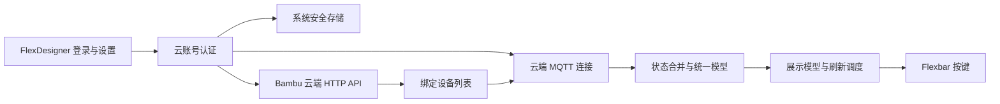

# Bambu Monitor 云端优先设计方案

## 1. 项目目标

为 Flexbar 开发一款 Bambu Lab 打印机状态监控插件。用户在 FlexDesigner 中登录 Bambu 云账号，选择已绑定的打印机，并在 Flexbar 上查看设备状态和打印进度。

项目优先接入云端，无需用户填写打印机局域网 IP 或 LAN Access Code。第一阶段先完成账号登录和设备发现，随后实现云端实时监控；打印控制、摄像头及历史统计暂不纳入第一版。

> 本文为实施方案，并非已完成的功能。当前项目仍是 FlexCLI 生成的计数器示例。

## 2. 背景与约束

- 插件后台运行在 FlexDesigner 的 Node.js 环境，界面通过 FlexDesigner 提供的插件机制与后台通信，Flexbar 按键由后台绘制。
- 当前项目使用 FlexCLI、JavaScript、Rollup 和 FlexDesigner SDK。先沿用现有工具链，按职责拆分模块。
- 社区整理的 Bambu 个人账号云接口和 MQTT 协议并非本文所能确认的稳定官方公共 API；登录方式、区域地址和可用字段可能变化，需要针对实际账号、机型和固件验证。
- Bambu 的 [Fleet Hub 开发者接入](https://bambulab.com/en/fleet-hub/developer)是另一条官方接入路径，其适用范围与普通个人账号的关系需要另行确认。
- 用户需在设置中明确选择账号区域；不能根据系统时区或 IP 地址猜测账号区域。

## 3. 用户体验

### 3.1 初始配置

1. 用户在 FlexDesigner 中打开插件设置，选择账号区域。
2. 输入 Bambu 账号及密码；服务端要求时继续输入邮箱验证码或双重认证信息。
3. 登录成功后，插件读取当前账号绑定的设备列表。
4. 用户选择要显示的打印机，并将监控按键添加到 Flexbar。
5. 插件连接云端状态通道；收到数据后显示设备状态。

### 3.2 Flexbar 展示

| 情况 | 建议显示 |
| --- | --- |
| 未登录 | 请登录 Bambu 账号 |
| 登录已失效 | 登录已失效，请重新登录 |
| 未选择打印机 | 请选择打印机 |
| 连接中 | 正在连接云端 |
| 等待首次状态 | 等待打印机状态 |
| 打印机离线 | 打印机离线及最后更新时间 |
| 空闲 | 打印机空闲，可附可用温度 |
| 打印中 | 进度、剩余时间及可用温度 |
| 暂停 | 已暂停及当前进度 |
| 完成 | 打印完成 |
| 异常 | 打印异常及可确认的错误码 |
| 云端断开 | 云连接中断及最后更新时间 |

按键可切换进度、温度和任务信息视图。实际布局和支持字段以 Flexbar、FlexDesigner 和目标机型实测为准。

## 4. 总体架构



模块职责：

1. **认证模块**：处理登录状态、验证码、令牌有效性和退出登录。
2. **云 API 模块**：封装区域配置、HTTP 请求和设备列表；只暴露应用所需的数据。
3. **设备管理模块**：管理已选设备和监控生命周期，为多设备扩展预留空间。
4. **云 MQTT 模块**：连接、订阅、重连、接收原始状态报告。
5. **状态模块**：合并完整及增量报告，映射为统一领域模型。
6. **展示模块**：生成显示内容、限制绘制频率，并处理 FlexDesigner 按键事件。
7. **凭据存储模块**：通过明确的接口访问系统安全存储，避免业务层直接处理平台差异。

## 5. 账号登录设计

### 5.1 登录状态机

```text
未登录 → 登录中 → 等待验证码 / 等待二次验证 → 已登录
                       ↘ 登录失败，可由用户重试

已登录 → 令牌过期或被撤销 → 需要重新登录
```

服务端的响应决定后续步骤；遇到未支持的认证方式时，说明限制并停止，不绕过验证。界面区分账号密码错误、验证码错误或过期、请求受限、网络失败及区域不匹配等情形。认证失败和限流时不循环自动提交。

### 5.2 实现依据

[OpenBambuAPI 云接口资料](https://raw.githubusercontent.com/Doridian/OpenBambuAPI/main/cloud-http.md)记录了以下接口，可作为技术验证的起点：

- `POST /v1/user-service/user/login`：账号登录。
- `GET /v1/iot-service/api/user/bind`：获取绑定设备。
- `GET /v1/design-user-service/my/preference`：社区资料中用于获取云 MQTT 所需用户标识。

这些资料是社区整理结果，不能保证当前所有账号、区域和认证方式可用。请求参数、验证码流程、服务地址及账号权限需要逐项验证；应用层不直接依赖固定响应结构，统一由云端适配器转换和处理错误。

### 5.3 令牌与凭据

- 密码和验证码仅用于当前认证流程，不持久化；登录完成或取消后从可控内存引用中清除。
- 优先使用 macOS 钥匙串或 Windows 凭据管理器保存令牌。能否从当前插件运行环境可靠调用安全存储，须先做跨平台验证。
- 普通插件配置仅保存区域、所选设备 ID 和非敏感显示偏好；不能假设 SDK 配置存储适合保存密钥。
- 令牌、密码、验证码、授权头和原始完整响应均不得写入日志。设备列表可能包含 LAN Access Code，诊断信息也需脱敏。
- 令牌过期或被撤销后提示用户重新登录。[社区资料](https://raw.githubusercontent.com/Doridian/OpenBambuAPI/main/cloud-http.md)提示其记录的令牌刷新接口可能不可用；仅在当前账号实际验证成功后启用刷新。
- 退出登录时关闭云连接、删除本地令牌并清除设备缓存。服务端会话能否同时撤销，取决于接口是否可用及验证结果。

## 6. 设备发现与云端监控

### 6.1 设备列表

登录后读取账号下的绑定设备，展示设备名称、型号和在线状态。用户选择设备后保存其 ID；不依赖用户手工输入打印机 IP。后续多个按键可选择不同打印机，共享账号会话和设备连接。

设备列表为空、无权限、服务不可用分别给出明确提示；设备名称变更、解除绑定及账号切换后应刷新本地选择状态。

### 6.2 云 MQTT

[OpenBambuAPI MQTT 文档](https://raw.githubusercontent.com/Doridian/OpenBambuAPI/main/mqtt.md)描述了使用云账号令牌连接 MQTT 并订阅 `device/{DEVICE_ID}/report` 的社区方案。实际使用前必须验证目标区域的服务地址、用户标识、令牌权限、TLS 证书和该账号的设备推送能力。

- 连接成功后订阅所选设备的状态主题，处理云端状态报告。
- 使用 TLS 并验证证书，不全局关闭验证。
- 网络断开采用带随机抖动的指数退避重连；认证失效时停止持续重试，提示重新登录。
- 若需要主动请求完整状态，应先验证目标云端路径和机型是否支持。此类请求是状态查询，不是打印控制；请求频率需受限。[社区资料](https://raw.githubusercontent.com/Doridian/OpenBambuAPI/main/mqtt.md)建议 P1P 的 `pushall` 间隔至少 5 分钟，避免影响设备性能。重连和手动刷新应共享冷却限制。
- 如 MQTT 在目标账号或机型上不可用，另行评估云 HTTP 状态接口作为低频、非实时降级；显示最后更新时间，不承诺其包含温度或所有实时字段。

### 6.3 状态模型

```ts
type PrinterState = {
  printerId: string;
  connection: 'connecting' | 'connected' | 'disconnected' | 'error';
  activity: 'unknown' | 'idle' | 'preparing' | 'printing'
          | 'paused' | 'finished' | 'failed';
  progressPercent: number | null;
  remainingMinutes: number | null;
  taskName: string | null;
  nozzle: { current: number | null; target: number | null };
  bed: { current: number | null; target: number | null };
  errorCode: string | null;
  lastReportAt: number | null;
};
```

`null` 表示未知或不可用，不转换成零。无法识别的原始状态映射为 `unknown`，错误码仅在含义可确认时解释，否则显示原始错误码。字段与单位必须以目标机型和真实报文验证。

| 业务信息 | 社区资料中的常见字段 | 处理 |
| --- | --- | --- |
| 设备状态 | `gcode_state` | 映射为统一状态，未知值保留 |
| 打印进度 | `mc_percent` | 检查范围 0–100 |
| 剩余时间 | `mc_remaining_time` | 通常按分钟处理，实机确认 |
| 任务名称 | `subtask_name` | 显示时截断过长内容 |
| 喷嘴温度 | `nozzle_temper`、`nozzle_target_temper` | 显示当前值和可用目标值 |
| 热床温度 | `bed_temper`、`bed_target_temper` | 显示当前值和可用目标值 |
| 异常 | `print_error`、`hms` 等 | 按已验证的映射显示 |

### 6.4 增量合并与刷新

- 部分设备报告增量字段：缺失字段保留已有值，显式空值按已验证的字段语义处理。
- 数组不能一律深合并；AMS 等复杂字段需单独建模，第一版可暂不解析。
- 每次报告记录时间；必要时为字段记录更新时间。连接存活不等同于所有数据均为最新。
- 收到完整快照、设备切换、账号切换及任务切换时，按明确规则清理旧字段，避免把旧任务数据带入新任务。
- 数据到达时立即更新内存；Flexbar 常规绘制初始建议最多每秒一次，状态切换、断线和故障可立即更新。
- 完成与故障通知按任务标识和状态转换去重。剩余时间以设备上报为准，本地估算必须明确标注并在新数据到来时校正。

## 7. 工程结构

```text
src/
  plugin.js                   # FlexDesigner 入口、事件及生命周期
  auth/
    auth-service.js           # 登录状态机
    credential-store.js       # 系统安全存储接口
  cloud/
    cloud-api.js              # 云 HTTP 请求和响应适配
    region.js                 # 账号区域配置
    cloud-mqtt.js             # MQTT 连接和重连
  printer/
    printer-manager.js        # 设备管理与监控生命周期
    state-reducer.js          # 快照和增量合并
    state-mapper.js           # 原始状态转统一模型
  display/
    presenter.js              # 状态转展示模型
    key-renderer.js           # 调用 FlexDesigner 绘制 API
  util/
    logger.js                 # 脱敏日志

com.upkiry.bambumonitor.plugin/
  manifest.json               # 按键、配置入口与本地化文案
  ui/
    account-settings.vue      # 登录、验证码和退出登录
    printer-settings.vue      # 设备选择
  resources/

test/
  fixtures/                   # 脱敏的认证响应和设备状态样本
  auth-service.test.js
  state-reducer.test.js
  state-mapper.test.js
  cloud-mqtt.test.js
```

具体接入时，将当前计数器示例替换为监控按键；入口只负责协调事件和服务，不承载协议细节。配置界面与后台的消息方式、SDK 包名和可用接口以项目实际安装版本及实测为准。参考 [FlexDesigner SDK 文档](https://eniac-tech.github.io/FlexDocumentation/flexbar/en/sdk/sdk_api_reference.html)。

## 8. 分阶段实施与验收

### 阶段 0：技术验证

- 确认目标账号区域、打印机型号和固件版本。
- 验证目标账号的登录、验证码或双重认证流程及区域地址。
- 验证插件运行环境能否安全使用系统凭据存储。
- 验证设备列表与云 MQTT 能否访问目标设备。

**验收**：形成脱敏的接口行为记录，明确可用与不可用能力，以及未解决的兼容性问题。

### 阶段 1：登录与设备发现

- 实现登录状态机、验证码交互、令牌安全保存与退出登录。
- 实现设备列表和设备选择；配置入口连接 FlexDesigner。
- 对认证失败、网络异常和无绑定设备提供可操作的提示。

**验收**：登录成功后可列出并选择设备；重启 FlexDesigner 后在令牌有效时恢复会话；退出登录后清除本地凭据。若系统安全存储不可用，先明确处理方案，不将明文持久化作为默认行为。

### 阶段 2：云端监控

- 接入云 MQTT、状态合并、重连和设备状态展示。
- 实现进度、剩余时间、任务名、温度中目标设备实际提供的字段。
- 明确显示云连接状态、打印机离线状态和数据更新时间。

**验收**：打印时显示真实状态；网络断开、设备离线、令牌失效均能正确区分；连接恢复后重新同步，不将旧状态标为实时。

### 阶段 3：体验与扩展

- 完善暂停、完成、故障显示和通知去重。
- 增加按键视图切换、配置迁移与多设备支持。
- 根据实机验证扩展 AMS、层数和错误码说明。摄像头、历史统计和打印控制另行设计。

## 9. 测试策略

- **单元测试**：登录状态转换、失败分类、字段映射、增量合并、空值与未知值、任务切换、通知去重。
- **集成测试**：用模拟 HTTP/MQTT 服务验证验证码流程、令牌失效、断线重连、无效报文、TLS 错误与状态请求冷却。
- **实机测试**：记录账号区域、机型和固件，覆盖空闲、打印、暂停、完成、设备离线、网络中断和恢复。
- **Flexbar 测试**：验证显示截断、状态颜色、刷新频率、按键重新加载和 FlexDesigner 重启后的恢复。
- **隐私测试**：检查日志、测试样本与配置导出，确保没有密码、验证码、令牌或设备 Access Code。

## 10. 待确认事项

1. Bambu 账号所属区域、打印机型号及固件版本。
2. 当前账号实际触发的登录验证类型与云 MQTT 访问能力。
3. 目标平台中系统安全存储的可用性，以及插件打包后的依赖兼容性。
4. 不同机型上可用状态字段、状态完整性及云端推送延迟。
5. FlexDesigner 设置界面与当前 SDK 版本的实际交互能力。

## 参考资料

- [FlexDesigner SDK](https://eniac-tech.github.io/FlexDocumentation/flexbar/en/sdk/sdk_api_reference.html)
- [OpenBambuAPI：云 HTTP 接口（社区）](https://raw.githubusercontent.com/Doridian/OpenBambuAPI/main/cloud-http.md)
- [OpenBambuAPI：MQTT 协议（社区）](https://raw.githubusercontent.com/Doridian/OpenBambuAPI/main/mqtt.md)
- [Bambu Lab 第三方集成说明](https://wiki.bambulab.com/en/software/third-party-integration)
- [Bambu Lab Fleet Hub 开发者中心](https://bambulab.com/en/fleet-hub/developer)
