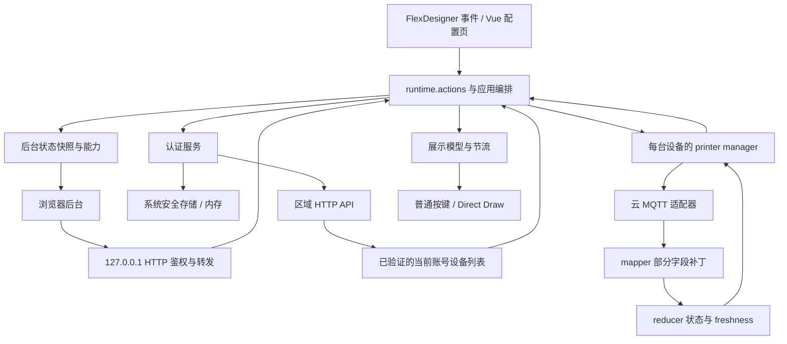

# 开发指南

本文面向维护者，按当前仓库源码说明职责边界、数据语义和开发验证流程。仓库协作约定见 [AGENTS.md](../AGENTS.md)，功能入口见 [README.md](../README.md)，方案与验收进度见 [云端监控设计方案](云端监控设计方案.md)，实际操作见 [macOS 真机验收指南](macOS真机验收指南.md)。本文不新增任何真机验收通过结论；协议依据、自动测试、独立后台观察和宿主实测应分别记录。

## 1. 项目边界与目录

插件提供云端只读监控。允许登录、发现绑定设备、订阅遥测、手动请求完整状态；不提供暂停、恢复、停止打印、温度设置或耗材操作。正式链路使用 Node.js HTTP/MQTT，不依赖 Python；目录里遗留的 Python 缓存不属于运行入口。

```text
src/
  plugin.js                 FlexDesigner 入口与退出接线
  runtime.js                应用编排、配置、宿主事件与调度
  auth/                     登录会话和安全凭据存储
  cloud/                    区域、HTTP API、MQTT 适配
  printer/                  生命周期、领域映射、增量状态、展示能力
  display/                  展示模型、普通按键、Direct Draw、字体
  admin/                    本机 HTTP 后台、浏览器启动、诊断与脱敏
  util/                     安全日志
com.upkiry.bambumonitor.plugin/
  manifest.json             插件元数据、入口及按键声明
  ui/                       FlexDesigner Vue 配置页
  resources/admin/          浏览器后台 HTML、JS、CSS
  resources/                图标、字体等静态资源
  backend/                  Rollup 生成，已忽略
scripts/admin-dev.js         独立后台开发入口
test/                       Node.js 单元与集成边界测试
docs/                       开发、设计和验收文档及 UI 概念素材
rollup.config.mjs            Node 后端打包配置
```

目录说明以实际路径为准：[源码](../src/)、[发布目录](../com.upkiry.bambumonitor.plugin/)、[测试](../test/)、[独立后台脚本](../scripts/admin-dev.js)、[构建配置](../rollup.config.mjs)。UI 概念稿在 [ui-concepts](ui-concepts/)，不能当作当前功能或真机效果的证明。

### 模块职责

| 位置 | 职责与边界 |
| --- | --- |
| [plugin.js](../src/plugin.js) | 获取 SDK、宿主 Canvas 和字体，创建 runtime/admin，启动宿主及服务，注册退出清理。只做接线，不放协议解析。 |
| [runtime.js](../src/runtime.js) | 组合认证与打印机管理器，串行读写配置，处理宿主/UI 消息、设备归属校验、按键设备选择、绘制节流和关闭。默认设备与按键指定的其他设备共享账号；不同设备使用各自管理器。 |
| [auth-service.js](../src/auth/auth-service.js) | 登录、验证码、恢复会话、失效和退出；异步代次与凭据操作队列避免过时登录结果覆盖新会话。 |
| [credential-store.js](../src/auth/credential-store.js) | 封装 macOS 钥匙串及内存回退；Windows 安全持久化尚未实现。业务层不直接调用系统命令。 |
| [region.js](../src/cloud/region.js) / [cloud-api.js](../src/cloud/cloud-api.js) | 区域地址、HTTP 超时和错误分类、认证流程、白名单设备摘要与用户 ID。刷新令牌方法存在，但默认不启用。 |
| [cloud-mqtt.js](../src/cloud/cloud-mqtt.js) | TLS、主题校验、订阅、退避重连、认证失败停止重试、报文尺寸/JSON 检查及只读完整状态请求。 |
| [printer-manager.js](../src/printer/printer-manager.js) | 一台设备的连接及状态生命周期；调用 reducer 并通知上层。通过代次隔离旧回调，等待旧连接关闭；不读配置、不绘制。 |
| [state-mapper.js](../src/printer/state-mapper.js) | 将协议字段转换为部分领域补丁，只解释实际出现且格式可接受的字段。 |
| [state-reducer.js](../src/printer/state-reducer.js) | 不修改输入状态；合并增量、处理任务/设备切换、AMS 层级与字段新鲜度。 |
| [model-catalog.json](../src/printer/model-catalog.json) / [capabilities.js](../src/printer/capabilities.js) | 官方型号 ID、产品名与别名共用能力配置；依据当前机型及映射读数决定展示资格，不缓存设备能力。 |
| [presenter.js](../src/display/presenter.js) | 纯展示逻辑、状态文案、字段新鲜度、视图和绘制指纹/节流；不调用宿主。 |
| [key-renderer.js](../src/display/key-renderer.js) / [dashboard.js](../src/display/dashboard.js) / [fonts.js](../src/display/fonts.js) | 普通按键和 Direct Draw 输出、字段旧值标记及字体注册。运行时避免普通 draw 覆盖 Direct Draw 触摸区。 |
| [server.js](../src/admin/server.js) / [open-browser.js](../src/admin/open-browser.js) | 本机鉴权、静态资源白名单、请求限制、动作转发和系统浏览器入口；业务动作共用 runtime。 |
| [diagnostics.js](../src/admin/diagnostics.js) / [debug-redaction.js](../src/admin/debug-redaction.js) / [logger.js](../src/util/logger.js) | 内存诊断、递归与文本脱敏、数量/体积限制和日志去重；观察器失败不能中断监控。 |
| [浏览器页面](../com.upkiry.bambumonitor.plugin/resources/admin/) | 原生 HTML/JS/CSS，轮询本机状态和诊断，展示传感器、AMS 与故障；不直接连接云端或保存云令牌。 |
| [configPage.vue](../com.upkiry.bambumonitor.plugin/ui/configPage.vue) / [monitor.vue](../com.upkiry.bambumonitor.plugin/ui/monitor.vue) | 宿主全局后台入口与按键设备配置。名称须与 [manifest.json](../com.upkiry.bambumonitor.plugin/manifest.json) 的对应配置页约定一致；不要仅添加 Vue 文件就认为宿主已挂接。 |

## 2. 数据流与依赖注入



登录成功后先读取设备列表，只有当前会话成功验证的设备可以开始监控。配置里已有设备 ID、按键上有设备 ID，或上次登录曾出现过设备，都不能代替当前账号归属验证。切换账号、区域、设备或退出时，必须保留现有代次校验和关闭顺序，防止旧请求、旧订阅或旧绘制污染新状态。

MQTT 只把目标设备 report 主题中的可接受 `print` 对象及白名单 AMS 身份信息交给 manager。mapper 不持有历史值；reducer 合并后才形成完整领域状态。展示层消费领域值、能力和 freshness，不自行猜协议。浏览器轮询读取的是本机内存快照；轮询成功不等于打印机有新报文。

依赖使用工厂参数显式注入，优先沿用以下接缝：

| 工厂 | 主要可注入依赖 | 开发用途 |
| --- | --- | --- |
| `createPluginRuntime` | `plugin`、`createApi`、`credentialStore`、`createMqttManager`、`drawKeyFn`、`drawDashboardFn`、`createCanvas`、`now`、`diagnostics` | 脱离宿主验证登录到状态/绘制编排，控制配置响应和并发。 |
| `createAuthService` | `createApi`、`credentialStore`、`logger`、`now` | 构造认证结果、存储失败、过期与取消竞争。 |
| `CloudApi` | `requestFn`、区域配置、`onRequest`、`onFrame` | 手写 HTTP 响应与错误，不访问真实账号。 |
| `createPrinterManager` | `createMqttClient`、`now`、`closeTimeoutMs`、`onFrame` | 验证连接切换、旧事件隔离和关闭失败。 |
| `createCloudMqttClient` | `createClient`、`now`、`cooldownNow`、`random` 与退避/关闭时长 | 可重复地验证 MQTT 回调、退避和冷却，不依赖实网时间。 |
| `createCredentialStore` / `createKeychainBackend` | `backend` / `runner` | 模拟安全存储行为，避免测试操作用户真实凭据。 |
| `createAdminServer` | `runtime`、`diagnostics`、`openBrowserFn`、`token`、`now` | 校验鉴权和转发，不自动打开用户浏览器。 |

可参考 [runtime 测试](../test/runtime.test.js) 的假宿主、假 API、假 MQTT，以及 [printer manager 测试](../test/printer-manager.test.js)。新增协议处理放在 cloud/printer 层，新增展示逻辑放在 display 或后台页面；避免 runtime 继续吸收字段细节。

## 3. 字段语义：缺失、null、零和新鲜度

| 输入或事件 | 领域处理 | 展示约束 |
| --- | --- | --- |
| 增量中缺失字段 | 不产生该字段补丁，保留旧值与原更新时间。使用 `Object.hasOwn` 判断存在。 | 不因其他字段更新而把它变为实时。 |
| 显式 `null` | 对支持清空的字段写入未知，并记录该次更新。 | 显示未知/占位，不显示 0。 |
| 有效零值 | 保留 `0`、`0%`、`0℃`、零分钟；故障码 0 表示已报告无错。 | 使用类型/范围或空值判断，不用 `if (value)` 判断读数是否存在。 |
| 非法类型、格式或越界 | 按字段规则忽略无效领域更新；允许的 raw 标量另存。 | 不裁剪成正常值，不刷新有效值 freshness，不从 raw 猜值。 |
| 新的未知状态或错误码 | 活动状态映射 `unknown` 并保留原串；故障保留原始码。 | 不补造解释或把未知值当正常。 |
| 连接断开 | 保留数据，`reportStale` 及已有 freshness 标记为旧。 | 连接断开与打印机离线、打印故障分别表达。 |
| 连接恢复 | 连接状态变化本身不会刷新旧字段。 | 等待对应字段重新报告。 |

新鲜度由 `freshness.fields` 和 AMS 层级标记中的 `{ at, stale }` 表示。没有标记表示未收到有效更新；时间必须有限且不晚于当前时间。展示采用约五分钟阈值，超过阈值表示旧数据，不能据此断言设备离线。不同展示路径的阈值边界比较需保持一致；新增逻辑应覆盖恰好到期及时间回退。

`lastReportAt` 描述最近有效打印遥测更新，不代表全部字段同时更新。只有 AMS 身份元数据到达时，不得把打印遥测变为实时；仅 raw 更新（如非法标量）不得刷新对应百分比的时间。显式 `null` 可有新的时间戳，但值仍未知。

任务切换优先比较可用 `task_id`，回退比较未截断任务名；不能以进度下降推断切换。任务切换清理上个任务的进度、剩余时间、层数及身份/名称标记。设备切换整体重置。完整快照检测目前是核心字段组合的启发式标记，不能凭此把所有缺失字段清空，尤其不能丢掉未随报文出现的 AMS 数据。

温度与进度等数值规则分别定义：进度 0..100、剩余时间非负，温度接受有限数值；不得用统一的“正数才有效”规则。新协议打包温度由 mapper 解码；双喷头按明确活动喷头 ID 匹配，不能拿数组首项或 legacy 占位温度充当当前喷头。

### 风扇规则

热端使用 BambuHelper 普通模式的 0..15 档位换算，已与当前 mapper 和能力判断对照；不能沿用旧版“只保留 raw、始终隐藏”的规则。

| 领域键 | 原始字段 | 有效输入与百分比 |
| --- | --- | --- |
| `part` | `cooling_fan_speed` | 0..15 整数，数字或十进制整数字符串；`Math.round(v * 100 / 15)`。 |
| `auxiliary` | `big_fan1_speed` | 同上，保持现有 round 规则。 |
| `chamber` | `big_fan2_speed` | 同上，保持现有 round 规则。 |
| `heatbreak` | `heatbreak_fan_speed` | 0..15 整数，数字或十进制整数字符串；`Math.floor(v * 100 / 15)`。 |

热端缺失保留已有值；显式 `null` 清空；非法值只保留可接受的 raw，不猜百分比、不刷新有效百分比时间。小数、越界、布尔值、十六进制和打包编码都不能当十进制 PWM 档位。热端仅在有效百分比存在时显示，包含 `0%`；不能按机型凭空显示占位读数，当前不提供匹配打印机的十位档选项。这里是只读显示，无风扇调速操作。区分 15 档 PWM、百分比、RPM 和其他打包字段，不混用单位。

## 4. 机型能力与 AMS 约束

机型能力有两个条件：硬件/机型允许展示，且所需领域读数可用；新鲜度仍单独判断。能力为 true 不等于读数实时，也不等于该机型经过真机验收。

- [型号目录](../src/printer/model-catalog.json) 记录来源 URL 和 commit，官方 ID、产品名及别名共用同一 profile。维护时保留来源并检查别名冲突；不能只给产品名增加例外，漏掉同机型 ID。
- A1/A1 mini 的腔温、辅助风扇、机箱风扇被明确禁止展示，收到占位零也不能显示。P1P/P1S 的腔温同样受目录限制。未知型号保留原名称，按有效映射读数退化；没有明确能力信息的条目不能凭“已登记”推断硬件。
- 热端风扇按有效百分比判断显示，具体 floor 规则见上节；新增型号不应覆盖这条独立约束。

AMS 状态按 unit ID、slot ID 和 zone ID 合并，不能用数组位置当身份。缺失保留、`null` 表示该层未知、显式空数组清空该层；全是非法条目的非空数组不应被误判为明确空列表。映射及 reducer 都限制可保留的层级数量，防止异常报文无限扩张状态。

- 类型优先采用明确产品元数据；冲突视为未知。`rawInfo` 只按已确认的协议低位解释，未知/清空时不以打印机型号覆盖。A1 的 AMS Lite 回退仅在没有明确类型证据时适用，不能从任意数字编码猜商品名。
- 版本模块身份信息只提取白名单名称和 ID，不保留模块序列号或完整固件响应。AMS 3H 使用明确身份信息及 zone 数据；不能仅凭槽位数量或 ID 猜类型。
- `tray_exist_bits` 按十六进制处理，legacy 全局位图只约束已知四槽布局（unit 0..3、slot 0..3）。AMS 3H、带 zones 的布局、高编号/多槽布局不能套用旧四槽掩码。
- 新鲜的“空槽”证据会清除颜色、材质和余量等旧数据；过期、断线或时钟回退后的旧空槽不能阻挡新元数据。不能因为缺少槽位对象就断言无耗材。
- AMS Lite 不显示余量。其他 AMS 也须该槽位有 0..100 有效读数才显示，0 是有效余量；缺失、`null`、`-1` 不解释为 0%。
- 颜色只接受已映射的八位十六进制格式；状态保留原始值。温度、湿度、烘干剩余时间按 zone 自己的字段和 freshness 展示，不能一个 zone 更新刷新其他 zone。

## 5. 编码、命名与安全约束

遵循 [AGENTS.md](../AGENTS.md)：两个空格缩进、分号、`const`/`let`，函数和变量用 `camelCase`、类用 `PascalCase`、常量用 `UPPER_SNAKE_CASE`，用户文案使用简洁中文。[src](../src/) 使用 CommonJS，[Rollup 配置](../rollup.config.mjs) 使用 ESM；浏览器脚本和 Vue 页沿用各自环境，不引入后端 Node 模块。

协议原名保留 `snake_case`，领域字段用 `camelCase`；`raw*` 表示尚未解释或诊断所需的原始标量，不能让 UI 把它直接当已确认含义。新增字段需同时检查 mapper、reducer、freshness、capabilities、后台和绘制消费路径；不能只改一张卡片。

配置和凭据必须保持以下边界：

- 全局普通配置只保存 `region`、`printerId`、`printerName`；按键 `data.printerId` 是非敏感设备选择，空串使用后台默认设备。区域由用户明确选择，不按 IP/时区猜测。
- 密码、验证码仅用于当前流程；云令牌只进系统安全存储或内存。安全存储失败应明确提示重启后需重新登录，不增加明文文件或配置兜底。macOS 钥匙串写入通过子进程 stdin，写后读回确认；编码本身不等于加密。Windows 目前只有内存回退。
- HTTP 设备列表适配按白名单生成摘要，丢弃 `dev_access_code`。日志使用 [安全 logger](../src/util/logger.js)，不输出授权头、凭据、接入码或完整云端响应，异常只记录受控上下文。
- 调试帧经过适配层与 [递归脱敏器](../src/admin/debug-redaction.js)，认证/个人资料响应只留元数据；其他允许的帧受深度、节点、单帧与总量限制，存在内存中。调试帧不是可无条件分享的原始报文；分享前仍需检查。
- 本机后台仅监听 `127.0.0.1` 随机端口，使用每次进程生成的随机令牌、Host/Origin 校验、禁止 CORS、CSP、请求体上限与敏感动作限流。令牌由 URL fragment 进入页面会话，API 用 Bearer 头；后台完整地址也属于访问凭据，不能分享或写日志。
- MQTT 保持 TLS 证书校验，限定设备主题及报文大小；网络失败退避重连，认证失败停止重试。完整状态请求对同设备跨连接共享 5 秒冷却，提交成功只表示本地请求提交，不能声称设备已响应。不要为刷新 UI 自动高频请求完整状态。
- 测试样本手写且脱敏，禁止复制真实账号响应、设备序列号和凭据。扩展云字段先核实协议来源和目标机型验证方式；未确认语义保留 raw，不能凭命名猜测。

## 6. 日常开发与构建发布

命令以 [package.json](../package.json) 为准。使用 Node.js 20（配合仓库 [.nvmrc](../.nvmrc)）；FlexCLI 在 Node.js 26 下会因 JSON import assertion 语法不兼容失败。依赖包括 FlexDesigner SDK 和会打入后端的 `mqtt`；原生 `@napi-rs/canvas` 由宿主提供且保持 external，不把本机原生二进制打包为跨平台依赖。

首次准备环境才安装依赖；已有依赖时不为文档整理或一般检查重复安装：

```sh
nvm use
npm install
```

修改前查看工作区状态，避免覆盖别人尚未提交的源码、设计稿和文档。优先读相关层及现有测试；只修改本任务范围内文件，不手改生成的 backend，不提交日志、缓存或插件包。

| 场景 | 命令 | 注意事项 |
| --- | --- | --- |
| 运行全部测试 | `npm test` | 使用 Node 内置 `node:test` 与 `node:assert/strict`。 |
| 定向验证状态链路 | `node --test test/state-mapper.test.js test/state-reducer.test.js test/capabilities.test.js` | 用于字段修改的快速反馈，提交前再运行完整检查。 |
| 构建 | `npm run build` | Rollup 生成 backend/plugin.cjs；生产构建压缩，watch 带 sourcemap。 |
| 目录校验 | `npm run plugin:validate` | 校验发布目录/manifest，不能证明云接口或宿主运行通过。 |
| 独立后台 | `npm run admin:dev` | 假宿主，配置和令牌仅内存；会尝试打开浏览器，仍可进行真实云登录/连接。不可用于证明宿主 Canvas、钥匙串或设备触摸有效。 |
| 宿主联调 | `npm run dev` | 先启动 FlexDesigner；脚本 unlink/link，监听后端构建并重启、输出调试日志，会改变本机开发插件链接。 |
| 打包 | `npm run plugin:pack` | 在插件目录旁生成同名 flexplugin 包，产物不提交仓库。 |
| 本机安装 | `npm run plugin:install` | 使用 `--force` 覆盖同 UUID 插件，只在明确需要安装时运行。 |

构建监听明确加入 manifest 和顶层 Vue 配置页，源码由 Rollup 依赖图追踪。浏览器后台静态 HTML/JS/CSS 不在这组显式 watch 文件中，修改后需刷新页面；不要承诺它会自动触发后端重启或热更新。

提交/发布候选的基本检查顺序：

```sh
npm test
npm run build
npm run plugin:validate
```

需要分发时再核对 [package.json](../package.json) 与 [manifest.json](../com.upkiry.bambumonitor.plugin/manifest.json) 的版本、入口和配置页声明，执行打包，检查资源齐全和包内容。构建通过不等于签名、公证、Windows、不同架构或真实宿主兼容性通过。只改文档时应检查相对链接和差异；涉及并行代码修改时由集成者对最终工作区统一运行检查，避免把中途结果当最终证据。

## 7. 手动验收与有价值的测试

手动操作细节见 [macOS 真机验收指南](macOS真机验收指南.md)，进度记录统一放在 [云端监控设计方案](云端监控设计方案.md) 的进度章节。每次记录环境、插件/固件版本、操作、观察结果及仍未验证项；历史整体体验通过不能推广为所有字段、机型和异常路径通过。

涉及登录、云连接、绘制或配置持久化时，至少按改动覆盖以下相关项：

1. 在 FlexDesigner 打开后台，区域、登录及验证码提示正确；设备列表失败、空列表和未绑定设备不可误连。
2. 默认打印机、按键指定设备及多设备切换不串数据；旧账号/旧连接回调不会恢复过时状态。
3. 核对空闲/打印、任务切换、进度/剩余/层数、温度、故障及 AMS。检查缺失、显式 null、0、非法值和未知 raw 的区别。
4. 热端 0..15 的 floor 百分比与真实报文对应，包括 0%；未上报时隐藏，其他三风扇保持 round；无十档匹配选项。硬件不具备的传感器不因占位 0 出现。
5. 断网恢复及局部更新后，旧字段保留并标旧，仅实际更新字段恢复新鲜；不要通过人为制造打印故障验收错误路径。
6. 普通按键视图、Direct Draw 显示/触摸、完整状态冷却、页面切换与退出清理正常；请求提交与收到新报文分别观察。
7. 宿主内验证钥匙串授权、重启会话恢复、持久化失败提示和退出清理；独立后台与模拟 runner 不能替代此项。
8. 分享诊断前检查脱敏；确认没有凭据、完整后台地址或完整账号响应。

自动测试以能抓住真实回归为目标，不以数量或覆盖率凑数。修改可观察行为时，选择有区分度的边界和失败路径；测试输入与预期应来自业务规则，避免只把实现公式复制一遍或断言内部代码文本。低影响文档修改通常不需要新增测试。

- 字段映射：缺失/null/0、合法十进制字符串、非法类型/范围、未知状态、热端 floor 与其余 round 的差异点（如输入 1 分别为 6% 与 7%）。
- 状态合并：不修改输入、旧字段保留、任务/设备隔离、字段 freshness 独立、断线与时钟回退、AMS 清空/空槽过期/身份变化。
- 边界与安全：真实可触发的超时、鉴权失败、关闭竞争、旧请求返回、敏感数据跨诊断边界及容量限制。
- 展示：用户可见的隐藏资格、有效零值、旧值标记和错误优先级；不要仅凭快照/字符串匹配证明 UI 在宿主中可用。

复用现有工厂和假时钟，使测试无真实账号、无外网依赖、无真实钥匙串写入。新增测试须回答“它会阻止哪种用户可见或安全回归”。报告验证时分别列出实际执行的命令、失败原因和未完成的真机项目；未执行、依赖缺失或宿主不可用均不能记为通过。
