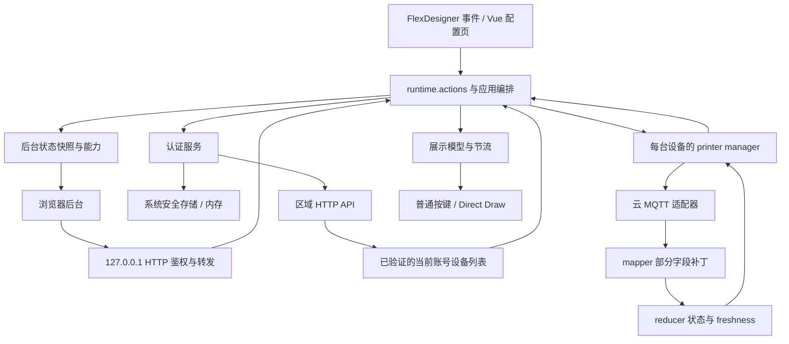

# 架构设计

本文说明当前模块如何协作。目录与开发命令见 [开发指南](开发指南.md)，字段及在线状态规则见 [设备协议与状态模型](设备协议与状态模型.md)，实际验证范围见 [验证状态](验证状态.md)。

## 项目边界

Bambu Monitor 是 FlexDesigner 的云端只读监控插件：通过本机浏览器登录 Bambu 账号，发现绑定设备，由 Flexbar 展示状态。使用 Node.js HTTP/MQTT，不依赖 Python，也无需填写局域网 IP 或设备接入码。完整状态查询包含手动请求和有限自动恢复；不提供打印控制、摄像头或历史统计。

普通个人账号云接口来自社区资料，并非本项目能够保证稳定的官方公共 API，需验证实际账号、区域、机型与固件。官方 [Fleet Hub](https://bambulab.com/en/fleet-hub/developer) 是另一条接入路径，尚未接入。

## 用户入口

1. 插件启动时创建 `127.0.0.1` 随机端口的后台服务；设置页的「进入后台」只负责拉起系统浏览器。服务失败时不阻断 Flexbar，并显示错误及可用的手动入口。
2. 浏览器完成区域选择、登录与验证码，读取绑定设备，再选择默认打印机。
3. 默认设备与按键指定的其他设备共享账号，各自有独立 manager。按键设备选择为空时使用默认设备。
4. 普通按键点击切换进度、温度和任务视图；Direct Draw 详情页触摸通过 `device.touch` 请求完整状态，并在任务名所在行短暂显示 Canvas 内联反馈；不使用设备原生 snackbar，避免与 Direct Draw 争用显示层。

设置页与浏览器共用 `runtime.actions`，不复制登录或 MQTT 状态机。浏览器通过同源 fetch 访问本机快照，不能直接访问云账号令牌。后台关闭或进程重启后需重新从设置页进入。

## 账号与区域

用户明确选择区域，不能按 IP 或时区猜测。当前入口限制中国大陆账号为手机号、全球账号为邮箱；手机号提交前去掉允许的空格和连字符。

云 HTTP 适配器将原始响应转换成受控领域结果，业务层不依赖完整云响应结构。当前参考接口如下，具体地址由 [region.js](../src/cloud/region.js) 与 [cloud-api.js](../src/cloud/cloud-api.js) 管理：

| 用途 | 接口 |
| --- | --- |
| 密码或验证码登录 | `POST /v1/user-service/user/login` |
| 全球邮箱验证码 | `POST /v1/user-service/user/sendemail/code`，`email` 与 `type=codeLogin` |
| 国区短信验证码 | `POST https://api.bambulab.cn/v1/user-service/user/sendsmscode`，`phone` 与 `type=codeLogin` |
| 绑定设备 | `GET /v1/iot-service/api/user/bind` |
| MQTT 用户标识 | `GET /v1/design-user-service/my/preference` |

国区使用 API 主机，避免网站主机的 Cloudflare 挑战。接口来源为 [ha-bambulab](https://github.com/greghesp/ha-bambulab) 与 [OpenBambuAPI HTTP 资料](https://raw.githubusercontent.com/Doridian/OpenBambuAPI/main/cloud-http.md)，来源记录不等于所有认证分支已实测。

## 登录状态机

```text
未登录 → 登录中 → 等待验证码 / 服务端要求的后续验证 → 已登录
              ↘ 失败，按错误类型提示用户重试
已登录 → 令牌过期或被撤销 → 需要重新登录
```

服务端决定后续步骤。未支持的认证方式明确说明并停止；认证失败或限流不循环自动提交。错误区分账号密码、验证码错误/过期、限流、网络、超时、未授权和区域不匹配。取消、区域切换与退出使用代次隔离，防止旧请求覆盖新会话。

macOS 使用系统钥匙串，不可用时提示并回退内存；Windows 安全持久化尚未实现。`refreshToken()` 有适配方法但默认不启用，过期要求重新登录。退出关闭监控、删除本地令牌并清设备缓存；服务端撤销能力仍取决于接口支持。凭据、后台令牌和诊断的完整安全约束统一见 [开发指南](开发指南.md#2-编码命名与安全约束)。

## 设备生命周期

登录成功后先验证当前账号的绑定设备；本地已有 ID 不能代替当前账号归属验证。设备列表失败或不包含所选设备时停止监控，说明原因并保留非敏感配置。

一台设备一个 manager：建立 TLS MQTT、订阅目标主题、解释设备事件、合并遥测并通知 runtime。manager 独立维护 presence 和恢复预算，runtime 周期 tick 推进无消息时的超时；tick 间隔跳变（休眠唤醒、时钟跳变）时执行盲窗恢复：标旧观测、重置刷新预算并重建云连接。broker 状态、设备 presence 和打印任务 activity 各自独立，具体转移及时间阈值只在 [协议文档](设备协议与状态模型.md) 定义。

换账号、区域、设备或退出时，先使旧代次失效，解除回调并等待旧连接关闭；无法确认关闭时阻止新监控。设备切换重置状态，同设备云连接恢复保留历史读数并标旧。多个设备各自管理状态和请求，不能将默认设备的事件用于其他按键。

网络失败采用抖动指数退避重连；认证失败停止持续重试并要求重新登录。当前没有 HTTP 实时状态降级，不能在 MQTT 不可用时宣称仍有实时监控。

## 展示与绘制

展示层消费统一领域值、能力、presence 和 freshness，不猜原始协议。浏览器按机型能力隐藏不支持或未上报的可选通道，空卡片隐藏；Flexbar 输出受限尺寸的状态与摘要。缺失、未知、有效零值和旧观测的语义见协议文档。

登录/设备选择是前置状态。连接与在线状态优先于历史任务；离线不将旧打印任务改为空闲。收到新遥测只刷新实际出现的字段，保留各自观测时间。

普通按键数据到达后立即更新内存，常规绘制通过指纹与每秒节流减少重复；首帧、状态变化、断线和故障可立即更新，定时器补画被节流的内容。Direct Draw 使用独立绘制会话，避免普通 draw 覆盖触摸区域；绘制失败不影响遥测链路。屏幕 `down` 触摸请求完整状态并显示反馈，同一屏幕/按键/打印机在 1800 毫秒通知窗口内合并重复触摸，不重复查询或排队通知。窗口不依赖可被 alive/data 替换的绘制会话，页面退出、设备断开及关闭时清理；窗口到期后的请求仍遵循 MQTT 的五秒冷却并显示实际结果。反馈作为展示模型字段传入同一 Canvas，暂时替换任务名一行；遥测重绘保留窗口内反馈，窗口结束在下一帧恢复任务名，不调用原生 snackbar。

剩余时间使用设备上报，不擅自倒计时。通知去重工具已提供，当前未接入系统完成/故障通知。长文字截断，错误未知含义保留原码。中文字体注册由宿主 Canvas 适配层处理，平台效果仍需实测。

Direct Draw 采用 2170 × 60 石墨黑/薄荷绿布局：设备身份与连接、任务与层数、百分比与进度线、设备上报的剩余时间、当前/目标温度、机型允许的风扇与 AMS 槽位、最近上报依次排列。`dashboard.js` 保留原有摘要接口；[dashboard-model.js](../src/display/dashboard-model.js) 构造逐字段 `{ text, stale }` 绘制数据，[dashboard-renderer.js](../src/display/dashboard-renderer.js) 只消费展示模型并通过实际字宽截断，不压缩文字。runtime 将对应设备型号注入能力判断。

槽位显示实际单元/槽位 ID、颜色、材质和允许展示的已上报余量；空槽不显示旧材质，Lite 隐藏余量。最多展示四个实际槽位，其他以数量提示，不猜测槽位布局。故障占用风扇/AMS 区域优先展示原始码和 HMS，旧故障标为历史；登录/设备选择前置态隐藏历史任务读数。预览与验收以宿主实际渲染为准；自动测试与浏览器检查不能替代硬件验收。

## 后台与诊断

本机服务校验随机令牌、Host/Origin、静态资源白名单、CSP、请求体上限与敏感动作限流。令牌每进程生成，经 URL fragment 进入页面会话，API 使用 Bearer；fragment 不隔离同用户下有进程查看权限的程序，完整后台地址应当作访问凭据。

诊断分为脱敏日志、HTTP 请求元信息和入站帧。请求追踪不记录请求头或请求体；调试帧可记录允许的 HTTP 响应/MQTT 内容，但认证/个人资料只留元信息，并经过递归脱敏、容量与体积限制。默认最多 100 帧、每帧 32 KiB、总量 1 MiB，只驻内存；截断与淘汰表示它不是完整历史档案。原有白名单诊断导出不包含新调试帧。

观察器异常不得影响业务；不可解析或超长报文只记录省略正文的元信息。安全维护细节见开发指南。

## 模块职责

| 位置 | 职责与边界 |
| --- | --- |
| [plugin.js](../src/plugin.js) | 获取 SDK、宿主 Canvas 和字体，创建 runtime/admin，启动宿主及服务，注册退出清理。只做接线，不放协议解析。 |
| [runtime.js](../src/runtime.js) | 组合认证与打印机管理器，串行读写配置，处理宿主/UI 消息、设备归属校验、按键设备选择、绘制节流和关闭。默认设备与按键指定的其他设备共享账号；不同设备使用各自管理器。 |
| [auth-service.js](../src/auth/auth-service.js) | 登录、验证码、恢复会话、失效和退出；异步代次与凭据操作队列避免过时登录结果覆盖新会话。 |
| [credential-store.js](../src/auth/credential-store.js) | 封装 macOS 钥匙串及内存回退；Windows 安全持久化尚未实现。业务层不直接调用系统命令。 |
| [region.js](../src/cloud/region.js) / [cloud-api.js](../src/cloud/cloud-api.js) | 区域地址、HTTP 超时和错误分类、认证流程、白名单设备摘要与用户 ID。刷新令牌方法存在，但默认不启用。 |
| [cloud-mqtt.js](../src/cloud/cloud-mqtt.js) | TLS、主题校验、订阅、退避重连、认证失败停止重试、报文尺寸/JSON 检查及只读完整状态请求；`recycle()` 供唤醒盲窗立即重建连接，不走退避。 |
| [printer-manager.js](../src/printer/printer-manager.js) | 一台设备的连接及状态生命周期；调用 reducer、独立维护 presence，暴露 `presence` / `tick()` 并通知上层。通过代次隔离旧回调，等待旧连接关闭；tick 跳变时执行盲窗恢复（标旧、重置预算、重建连接）；不读配置、不绘制。 |
| [monitor-registry.js](../src/printer/monitor-registry.js) | 按"默认设备 + 按键引用"收敛每设备连接：统一建连、订阅、幂等与关闭屏障；事件携带设备身份和连接令牌。关闭失败保留屏障，不允许替换未确认关闭的连接。 |
| [presence.js](../src/printer/presence.js) | 校验有效领域遥测证据，维护 presence、独立报文/遥测时间及有限自动恢复预算；阈值由可注入时钟驱动，唤醒 resume 重置失活快速档预算，时钟回拨下修被越过的时戳。 |
| [refresh-scheduler.js](../src/printer/refresh-scheduler.js) | 合并连接同步、在线字段补全、无响应恢复与周期兜底请求；周期兜底是活性底线，预算耗尽不停止自动刷新。共享自动间隔，独立维护字段补全预算，由 manager 的 tick 与实际请求结果驱动；唤醒 resume 重置节流与预算并强制同步。 |
| [state-mapper.js](../src/printer/state-mapper.js) | 将协议字段转换为部分领域补丁，只解释实际出现且格式可接受的字段。 |
| [state-reducer.js](../src/printer/state-reducer.js) | 不修改输入状态；合并增量、处理任务/设备切换、AMS 层级与字段新鲜度。 |
| [model-catalog.json](../src/printer/model-catalog.json) / [capabilities.js](../src/printer/capabilities.js) | 官方型号 ID、产品名与别名共用能力配置；依据当前机型及映射读数决定展示资格，不缓存设备能力。 |
| [presenter.js](../src/display/presenter.js) | 纯展示逻辑、状态文案、字段新鲜度、视图和绘制指纹/节流；不调用宿主。 |
| [display-controller.js](../src/display/display-controller.js) | 维护按键、视图、绘制节流、Direct Draw 会话与触摸反馈窗口；通过注入的展示输入与请求函数工作，不读配置、不访问令牌、不创建设备连接。避免普通 draw 覆盖 Direct Draw 触摸区。 |
| [key-renderer.js](../src/display/key-renderer.js) / [dashboard.js](../src/display/dashboard.js) / [fonts.js](../src/display/fonts.js) | 普通按键和 Direct Draw 输出、字段旧值标记及字体注册。 |
| [server.js](../src/admin/server.js) / [open-browser.js](../src/admin/open-browser.js) | 本机鉴权、静态资源白名单、请求限制、动作转发和系统浏览器入口；业务动作共用 runtime。 |
| [diagnostics.js](../src/admin/diagnostics.js) / [debug-redaction.js](../src/admin/debug-redaction.js) / [logger.js](../src/util/logger.js) | 内存诊断、递归与文本脱敏、数量/体积限制和日志去重；观察器失败不能中断监控。 |
| [浏览器客户端](../src/admin/client/) | 按职责拆为 `api`（鉴权请求与令牌）、`polling`（轮询与代次）、`view-model`（展示值与共享时效）、`render`（DOM）、`actions`（表单流程）、`diagnostics`（白名单导出）与 `main`（装配）。随生产构建打包到 [resources/admin/app.js](../com.upkiry.bambumonitor.plugin/resources/admin/app.js)。不直接连接云端或保存云令牌。 |
| [浏览器页面](../com.upkiry.bambumonitor.plugin/resources/admin/) | 原生 HTML/CSS 与构建产物 `app.js`，轮询本机状态和诊断，展示传感器、AMS 与故障。 |
| [configPage.vue](../com.upkiry.bambumonitor.plugin/ui/configPage.vue) / [monitor.vue](../com.upkiry.bambumonitor.plugin/ui/monitor.vue) | 宿主全局后台入口与按键设备配置。名称须与 [manifest.json](../com.upkiry.bambumonitor.plugin/manifest.json) 的对应配置页约定一致；不要仅添加 Vue 文件就认为宿主已挂接。 |

## 数据流与依赖注入



图中 MQTT → mapper → reducer 表示领域数据流；事件和消息到达另传 manager 的 presence。runtime 对默认及额外设备分别周期 tick，再形成后台/绘制快照。浏览器轮询成功仅说明本机服务可用，不等于打印机有新报文；具体证据规则见 [协议文档](设备协议与状态模型.md#3-presence超时与有限恢复)。

依赖使用工厂参数显式注入，优先沿用以下接缝：

| 工厂 | 主要可注入依赖 | 开发用途 |
| --- | --- | --- |
| `createPluginRuntime` | `plugin`、`createApi`、`credentialStore`、`createMqttManager`、`drawKeyFn`、`drawDashboardFn`、`createCanvas`、`now`、`diagnostics` | 脱离宿主验证登录到状态/绘制编排，控制配置响应和并发。 |
| `createAuthService` | `createApi`、`credentialStore`、`logger`、`now` | 构造认证结果、存储失败、过期与取消竞争。 |
| `CloudApi` | `requestFn`、区域配置、`onRequest`、`onFrame` | 手写 HTTP 响应与错误，不访问真实账号。 |
| `createPrinterManager` | `createMqttClient`、`now`、`closeTimeoutMs`、`onFrame` | 验证连接切换、旧事件隔离和关闭失败。 |
| `createCloudMqttClient` | `createClient`、`now`、`cooldownNow`、`random` 与退避/关闭时长 | 可重复地验证 MQTT 回调、退避和冷却，不依赖实网时间。 |
| `createCredentialStore` / `createKeychainBackend` | `backend` / `runner` | 模拟安全存储行为，避免测试操作用户真实凭据。 |
| `createAdminServer` | `runtime`、`diagnostics`、`openBrowserFn`、`token`、`now` | 校验鉴权和转发，不自动打开用户浏览器。 |
| observation-policy | `presence`、字段标记与 `now` | 展示层、Dashboard 与浏览器共用同一时效判断，不各自维护阈值。 |
| `createMonitorRegistry` | `createManager`、`logger`、`onFrame`、`onEvent` | 脱离真实 MQTT 验证多设备收敛、复用、关闭屏障与会话事件归属。 |
| `createDisplayController` | `plugin`、`now`、`createCanvas`、`drawKeyFn`、`drawDashboardFn`、`resolvePrinterId`、`buildKeyDisplay`、`buildDashboardInput`、`inspectPrinter`、`requestFullState` | 脱离宿主验证按键、Direct Draw、触摸合并与销毁清理。 |

可参考 [runtime 测试](../test/runtime.test.js) 的假宿主、假 API、假 MQTT，以及 [printer manager 测试](../test/printer-manager.test.js)。新增协议处理放在 cloud/printer 层，新增展示逻辑放在 display 或后台页面；避免 runtime 继续吸收字段细节。

## 参考资料

- [FlexDesigner SDK](https://eniac-tech.github.io/FlexDocumentation/flexbar/en/sdk/sdk_api_reference.html)：宿主事件、配置与绘制接口。
- [Bambu Lab 第三方集成说明](https://wiki.bambulab.com/en/software/third-party-integration)：集成背景；协议字段的固定来源见 [协议文档](设备协议与状态模型.md#8-故障原始信息与依据)。
